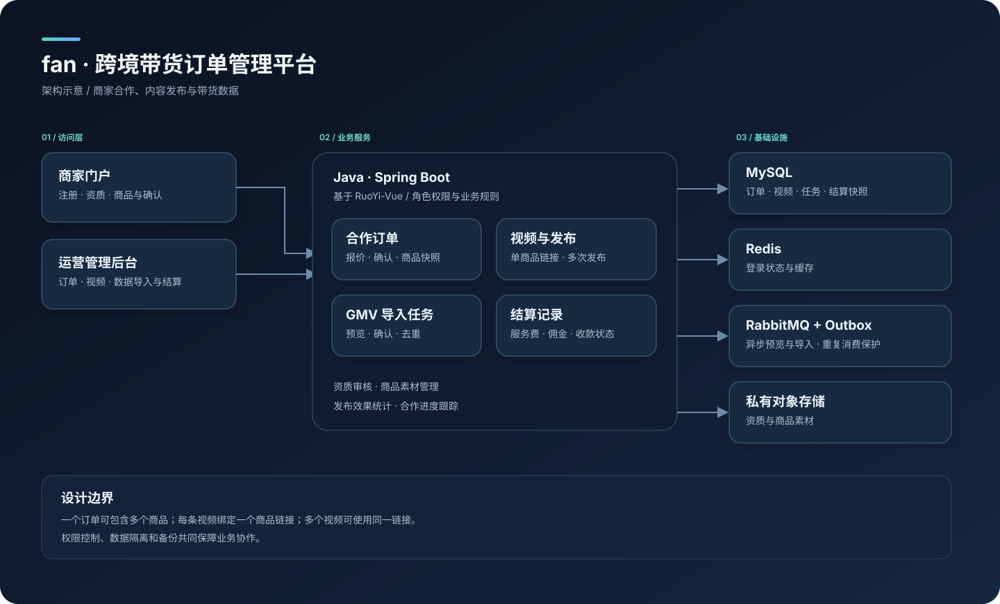

# fan · 跨境带货订单管理平台

面向跨境电商团队的商家合作、带货数据与结算管理平台。

fan 是一个面向跨境带货公司的合作订单管理系统。商家提交资质、商品和参考素材；运营团队创建合作订单，记录视频发布及带货 GMV，并按约定管理服务费和佣金。AI 视频在外部系统生成，本项目只记录视频及结果。



## 业务规则

- 商家注册并提交资质，通过审核后开展合作。
- 一笔合作订单可包含多个商品，每个商品可约定不同佣金比例。
- 一条视频关联一个商品链接；多条视频可使用同一商品链接。重新发布产生新的发布记录。
- 基础服务费由运营按商家约定手动填写，异常调整需商家确认。
- 佣金以导出系统中已扣退款的最终 GMV 为基础计算；第一版使用美元。
- 不要求商家寄送样品，也不在平台内生成 AI 视频或执行资金支付。

## 功能模块

| 模块 | 主要功能 |
| --- | --- |
| 商家与资质 | 商家注册、资质上传、内部审核及商家账户隔离 |
| 商品与素材 | 商品登记、图片提交及内部审核 |
| 合作订单 | 多商品合作、商品佣金设置、商家在线确认 |
| 视频与发布 | 视频登记、商品链接绑定、发布记录 |
| 带货数据 | 视频级 GMV 导入、异步预览、确认及汇总 |
| 费用与结算 | 服务费调整、商家确认、结算及人工收款记录 |

异步导入使用数据库 outbox、RabbitMQ 和任务状态保护；单文件上限 8 MB、10,000 行，使用内存解析，预览返回前 100 行。结算记录不发起支付。

## 技术栈

- 后端：Java 17、Spring Boot 3、Spring Security、MyBatis、Maven。
- 前端：Vue 3、Vite、Element Plus。
- 基础设施：MySQL、Redis、RabbitMQ；可选 S3 兼容私有对象存储。
- 上游基础：[RuoYi-Vue](https://github.com/yangzongzhuan/RuoYi-Vue) 的 `springboot3` 分支和 [RuoYi-Vue3](https://github.com/yangzongzhuan/RuoYi-Vue3)。

## 项目目录

```text
fan/
├── backend/              Java 后端
│   ├── admin/            API 与应用启动
│   ├── commerce/         业务规则
│   ├── common/           通用组件
│   ├── framework/        基础配置和安全框架
│   ├── system/           用户、角色和菜单
│   ├── quartz/           定时任务
│   └── sql/              数据库初始化及增量脚本
├── frontend/             Vue 3 前端
├── deploy/               本地容器配置示例
├── scripts/              本地管理员初始化脚本
└── docs/architecture.svg 系统架构图
```

## 本地启动

以下步骤只适用于隔离的开发环境。需要 Java 17、Maven 3.9、Node.js、pnpm、Python 3 和 Docker。数据库脚本会删除并重建相关表，**只能用于新建的空数据库**；不要指向已有业务数据库。

### 1. 配置并启动基础设施

将 `deploy/env.example` 复制为项目根目录的 `.env`，填写开发环境账号与密码。

```bash
cp deploy/env.example .env
# 编辑 .env，设置全部配置值

docker compose --env-file .env -f deploy/compose.yaml -p fan-local up -d
```

Compose 将端口绑定到本机：MySQL `13306`、Redis `16379`、RabbitMQ `15673`；管理界面为 `15672`。初始化脚本只在 MySQL 数据卷首次创建时运行。

### 2. 创建本地管理员

在本机 Python 虚拟环境中安装 `bcrypt` 和 `mysql-connector-python`，运行以下脚本。脚本交互式读取密码、不写入配置文件；仅连接本机 `13306` 端口的 `fan` 数据库。若管理员 ID 或用户名已存在，脚本会停止。

```bash
python -m venv .venv
# 激活虚拟环境后：
python -m pip install bcrypt mysql-connector-python
python scripts/bootstrap_admin.py
```

在后台创建其他内部账号前，请先配置账号初始化策略。

### 3. 配置并启动后端

在启动进程的环境中设置以下变量：

| 变量 | 用途 |
| --- | --- |
| `FAN_DB_URL` | MySQL JDBC 地址；本地端口为 `13306`，数据库名为 `fan` |
| `FAN_DB_USER`、`FAN_DB_PASSWORD` | 数据库应用账号 |
| `FAN_TOKEN_SECRET` | 独立生成的高强度 JWT 签名密钥；不可使用示例或默认值 |
| `SPRING_DATA_REDIS_PORT` | 本地设为 `16379` |
| `FAN_UPLOAD_PATH` | 本地上传目录，可按环境设置 |

例如，在类 Unix 开发环境可先设置数据库地址和 Redis 端口（用户名、密码与签名密钥应通过安全方式注入）：

```bash
export FAN_DB_URL='jdbc:mysql://127.0.0.1:13306/fan?useUnicode=true&characterEncoding=utf8&useSSL=false&serverTimezone=UTC&allowPublicKeyRetrieval=true'
export SPRING_DATA_REDIS_PORT=16379
```

如需启用异步导入，还需设置 `FAN_IMPORT_ENABLED=true`、`SPRING_RABBITMQ_HOST`、`SPRING_RABBITMQ_PORT=15673`、`SPRING_RABBITMQ_USERNAME`、`SPRING_RABBITMQ_PASSWORD`、`SPRING_RABBITMQ_PUBLISHER_CONFIRM_TYPE=correlated` 和 `SPRING_RABBITMQ_PUBLISHER_RETURNS=true`。对象存储需自行提供私有的 S3 兼容服务，并配置 `FAN_STORAGE_ENABLED`、`FAN_STORAGE_ENDPOINT`、`FAN_STORAGE_ACCESS_KEY`、`FAN_STORAGE_SECRET_KEY` 和可选的 `FAN_STORAGE_BUCKET`。

```bash
mvn -f backend/pom.xml test package
java -jar backend/admin/target/admin.jar
```

### 4. 启动前端

```bash
cd frontend
pnpm install --frozen-lockfile
pnpm dev
```

开发服务器默认监听本机 `5173` 端口；默认代理后端 `127.0.0.1:8080`，可用 `VITE_BACKEND_URL` 调整。商家入驻地址为 `/merchant-register`，商家工作台为 `/merchant`。

## Excel 导入格式

首个工作表的前两列依次为 `视频编号`、`最终GMV(USD)`；一行对应一个视频、金额为数字，且 GMV 已扣退款。同一文件不允许重复视频编号。调用接口时另需填写来源、UTC 统计截止时间和数据版本。真实导出格式、归因和版本规则仍需按实际数据验证。

## 开源许可与来源

本项目以 MIT 许可证发布；详见根目录 [LICENSE](LICENSE)。前端保留其上游 [LICENSE](frontend/LICENSE)。本项目基于 RuoYi 开源项目改造，感谢原作者和贡献者；使用其他依赖时请分别遵守其许可证。
